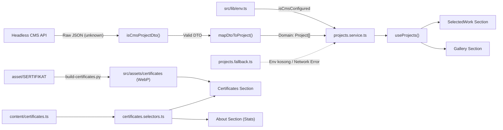

# PRD — Website Portofolio Sandi Setianto

| | |
|---|---|
| **Produk** | Website portofolio pribadi (single-page) |
| **Pemilik** | Sandi Setianto |
| **Versi dokumen** | 1.1 — Revisi Clean Code & Fullstack Architecture |
| **Tanggal** | 23 November 2026 |
| **Status** | Menunggu review pemilik |
| **Dokumen terkait** | `prompt.md` (instruksi implementasi untuk AI agent), `design/` (referensi visual), `asset/` (foto), `asset/SERTIFIKAT/` (sertifikat), `.agents/skills/` & `.claude/skills/` (standar engineering) |

> **Konvensi**
> - `[ISI: ...]` = data yang wajib dilengkapi pemilik sebelum rilis.
> - **P0** = wajib ada saat rilis v1 · **P1** = sebaiknya ada di v1 · **P2** = setelah v1.
> - Jika PRD ini bertentangan dengan `prompt.md`, PRD ini yang menjadi acuan produk & arsitektur; `prompt.md` acuan alur kerja agent.

---

## 1. Ringkasan

Website portofolio single-page yang memperkenalkan **Sandi Setianto**, mahasiswa Teknik Informatika UIN Sultan Syarif Kasim Riau (Pekanbaru), sebagai [ISI: role, mis. "Frontend Developer"] kepada rekruter, klien, dan penyelenggara program.

Situs menampilkan profil, proyek (dikelola lewat Headless CMS), layanan/keahlian, serta **19 sertifikat & penghargaan** yang dapat diverifikasi. Gaya visual **"Editorial Brutalist × Y2K Accents"** (merah–hitam–krem, tipografi condensed berukuran besar, aksen retro-futuristik) dipakai agar situs mudah diingat tanpa mengorbankan keterbacaan, aksesibilitas, dan performa.

Secara teknis, proyek ini dibangun dengan standar **Clean Code & Clean Architecture untuk React 19 + TypeScript Strict**: pemisahan tegas antara domain model, *Anti-Corruption Layer* (DTO mapper & runtime type guard) untuk Headless CMS, komponen UI murni berbasis komposisi (*compound components* tanpa *boolean prop proliferation*), serta manajemen *high-frequency animation state* bebas *re-render*.

## 2. Latar Belakang & Masalah

1. **Kredensial tersebar.** 11 kelas Dicoding, 2 tahap Samsung Innovation Campus, hackathon, kepanitiaan, dan penghargaan tersimpan sebagai file PDF/foto terpisah sehingga sulit ditunjukkan dalam satu tautan.
2. **Waktu perhatian pembaca singkat.** Rekruter perlu menangkap informasi inti (siapa, bisa apa, buktinya apa, cara menghubungi) secepat mungkin, idealnya di layar pertama.
3. **CV statis tidak membuktikan kemampuan engineering.** Website portofolio yang cepat, aksesibel, *type-safe*, dan memiliki kode yang bersih (*clean code*) sekaligus menjadi bukti langsung kualitas software engineering pemiliknya saat repo diinspeksi tech lead.
4. **Konten harus mudah diperbarui.** Proyek dan sertifikat akan terus bertambah; pembaruan tidak boleh mengharuskan pemilik mengubah kode komponen UI.

## 3. Tujuan & Non-Tujuan

### 3.1 Tujuan

| ID | Tujuan |
|---|---|
| G1 | Menyediakan **satu tautan profesional** untuk dicantumkan di CV, LinkedIn, dan lamaran magang/kerja/freelance. |
| G2 | Menyampaikan **identitas, keahlian, dan status ketersediaan** di layar pertama, dan bukti kerja dalam 1–2 kali scroll. |
| G3 | Menampilkan **seluruh kredensial secara terverifikasi** (link verifikasi resmi bila tersedia). |
| G4 | Menjadi **showcase kemampuan engineering**: skor Lighthouse tinggi, aksesibel, animasi halus 60fps, dan arsitektur kode React + TypeScript yang bersih serta mudah diuji. |
| G5 | **Mudah dirawat**: proyek via CMS tanpa deploy ulang; sertifikat via satu file data + satu script idempoten. |

### 3.2 Non-Tujuan (v1)

- Blog/artikel.
- Halaman studi kasus per proyek (`/work/:slug`) — **P2**.
- Multi-bahasa ID/EN — **P2**.
- Toggle dark mode (desain sudah memakai kontras terang–gelap per section).
- Form kontak dengan backend — v1 memakai `mailto:` + tombol salin email; form = **P2**.
- Dashboard admin custom — gunakan studio bawaan CMS.
- Login, komentar, e-commerce.

## 4. Metrik Keberhasilan

| Metrik | Target | Cara ukur |
|---|---|---|
| Lighthouse mobile — Performance | ≥ 90 | Lighthouse / PageSpeed Insights |
| Lighthouse mobile — Accessibility, Best Practices, SEO | ≥ 95 | Lighthouse |
| Largest Contentful Paint (LCP) | < 2,5 dtk (4G) | PageSpeed / Web Vitals |
| Cumulative Layout Shift (CLS) | < 0,1 | PageSpeed / Web Vitals |
| Interaction to Next Paint (INP) | < 200 ms | PageSpeed / Web Vitals |
| JavaScript awal (gzip) | ≤ 200 KB | output `npm run build` |
| Total berat thumbnail section sertifikat | ≤ 600 KB | DevTools Network |
| Pelanggaran TypeScript strict / `any` / `as` tidak sah | 0 | `tsc --noEmit` & ESLint |
| Link verifikasi sertifikat yang rusak | 0 | cek manual/otomatis sebelum rilis |
| Klik CTA kontak (email, LinkedIn, GitHub) | baseline di bulan pertama, lalu dipantau | analytics (P1) |
| Klik "Verifikasi" sertifikat | dipantau | analytics (P1) |

## 5. Target Pengguna

| Persona | Kebutuhan utama | Yang dicari di situs |
|---|---|---|
| **Rekruter / HR** | Menilai relevansi kandidat dengan cepat | Role, lokasi, status ketersediaan, skill, CV, kontak |
| **Tech lead / interviewer** | Menilai kualitas teknis & kebersihan kode | Proyek + live demo/repo, struktur repo portofolio, TypeScript strictness, performa UI |
| **Klien freelance / UMKM** | Mencari orang yang bisa membuat website | Contoh hasil, layanan, cara menghubungi |
| **Panitia program / beasiswa / magang** | Memverifikasi pencapaian | Sertifikat, penghargaan, link verifikasi |

## 6. User Stories

| ID | User story | Prioritas |
|---|---|---|
| US-01 | Sebagai **rekruter**, saya ingin melihat nama, role, lokasi, dan status ketersediaan di layar pertama, agar bisa langsung menilai relevansi. | P0 |
| US-02 | Sebagai **rekruter**, saya ingin menyalin email dengan sekali klik dan mengunduh CV, agar bisa menindaklanjuti dengan cepat. | P0 (email) / P1 (CV) |
| US-03 | Sebagai **tech lead**, saya ingin melihat proyek beserta stack, live demo, dan repo, serta melihat kode sumber portofolio yang rapi dan *type-safe*, agar bisa menilai kualitas engineering kandidat. | P0 |
| US-04 | Sebagai **panitia program**, saya ingin memfilter sertifikat per kategori dan membuka link verifikasinya, agar bisa memastikan keasliannya. | P0 |
| US-05 | Sebagai **pengunjung mobile**, saya ingin semua konten terbaca dan semua interaksi berfungsi dengan sentuhan. | P0 |
| US-06 | Sebagai **pengguna keyboard/screen reader**, saya ingin menavigasi seluruh situs, termasuk dialog, tanpa mouse. | P0 |
| US-07 | Sebagai **pengguna yang sensitif terhadap gerakan**, saya ingin animasi dikurangi saat `prefers-reduced-motion` aktif. | P0 |
| US-08 | Sebagai **pemilik**, saya ingin menambah/mengubah proyek lewat CMS tanpa deploy ulang kode. | P0 |
| US-09 | Sebagai **pemilik**, saya ingin menambah sertifikat baru cukup dengan menaruh file, menambah satu entri data, dan menjalankan satu script. | P0 |
| US-10 | Sebagai **pengunjung yang membagikan tautan**, saya ingin preview (judul, deskripsi, gambar) tampil rapi di LinkedIn/WhatsApp. | P1 |

## 7. Ruang Lingkup & Prioritas Fitur

| ID | Fitur | Prioritas | Catatan |
|---|---|---|---|
| F-01 | Top bar + navigasi anchor + menu mobile + skip link | P0 | |
| F-02 | Hero | P0 | Elemen LCP |
| F-03 | About + statistik | P0 | Angka sertifikat/penghargaan otomatis dari selector |
| F-04 | Gallery "Me" (kartu mengipas) | P1 | Dekoratif; di-lazy-load bila perlu |
| F-05 | Selected Work (data CMS + Anti-Corruption Layer + fallback) | P0 | |
| F-06 | What I Do | P0 | |
| F-07 | Certificates & Awards (highlights, filter, daftar, dialog) | P0 | |
| F-08 | Cursor preview sertifikat (desktop) | P1 | Aksen Y2K, berbasis `MotionValue` tanpa React re-render |
| F-09 | Footer CTA + kontak + sosial | P0 | |
| F-10 | Smooth scroll + animasi scroll & micro-interaction | P1 | Situs harus tetap utuh tanpa animasi |
| F-11 | Mode reduced-motion | P0 | `<MotionConfig reducedMotion="user">` + guard GSAP/Lenis |
| F-12 | Meta SEO, Open Graph, favicon | P0 | |
| F-13 | JSON-LD `Person`, `sitemap.xml`, `robots.txt` | P1 | |
| F-14 | Tombol unduh CV | P1 | Butuh file CV dari pemilik |
| F-15 | Analytics (privacy-friendly) | P1 | Butuh persetujuan dependensi |
| F-16 | Halaman studi kasus proyek | P2 | Butuh router |
| F-17 | Multi-bahasa ID/EN | P2 | |
| F-18 | Form kontak | P2 | |
| F-19 | Sertifikat dikelola via CMS | P2 | Kontrak tipe & adapter sudah disiapkan |

## 8. Kebutuhan Fungsional

### 8.1 Top Bar & Navigasi (F-01)
- **FR-NAV-1** Menampilkan role (kiri), "BASED IN PEKANBARU, INDONESIA" (tengah), status ketersediaan (mis. "AVAILABLE FOR PROJECTS") + monogram "SS" dalam lingkaran (kanan).
- **FR-NAV-2** Link anchor: **Work**, **Certificates**, **Contact**. Klik melakukan scroll halus ke section dan memperbarui hash URL.
- **FR-NAV-3** Di < 768px, navigasi diringkas menjadi tombol menu yang membuka panel overlay (focus trap, tutup dengan `Esc`, tertutup otomatis setelah link dipilih).
- **FR-NAV-4** Link "Skip to content" menjadi elemen fokus pertama.
- **Acceptance criteria:** semua link dapat dijangkau dengan `Tab`; tidak ada overlap teks di 375px.

### 8.2 Hero (F-02)
- **FR-HERO-1** Headline condensed 2–3 baris dengan dua warna (hitam + merah). Copy: [ISI: tagline].
- **FR-HERO-2** Foto `DSC07495` di atas blok merah vertikal; paragraf intro ≤ 25 kata di sisi kanan; indikator "⟶ SCROLL TO EXPLORE" di kiri bawah.
- **FR-HERO-3** Aksen dekoratif: marker crosshair `+` dan wordmark outline terdistorsi di layer belakang (`aria-hidden="true"`).
- **FR-HERO-4** Hanya ada satu `h1` di seluruh halaman.
- **Acceptance criteria:** foto hero adalah elemen LCP dan dimuat dengan `fetchpriority="high"`; headline tidak terpotong di 375px; tidak ada layout shift saat font dimuat.

### 8.3 About (F-03)
- **FR-ABOUT-1** Label "ABOUT ME", headline condensed dengan satu kata bergaris bawah merah, paragraf bio, dan tombol "MORE ABOUT ME ⟶" yang membuka paragraf tambahan (disclosure).
- **FR-ABOUT-2** Foto `DSC07498`.
- **FR-ABOUT-3** 4 statistik dengan angka merah besar dan efek count-up:
  - [ISI: tahun belajar/pengalaman]
  - Proyek — dihitung dari data proyek (atau [ISI] bila CMS belum terhubung)
  - **Sertifikat — dihitung otomatis dari selector data (saat ini 19)**
  - **Penghargaan — dihitung otomatis dari kategori `award` (saat ini 3)**
- **Acceptance criteria:** count-up hanya berjalan sekali saat terlihat; mode reduced-motion langsung menampilkan angka akhir; angka sertifikat/penghargaan diturunkan lewat pure selector, bukan di-hardcode.

### 8.4 Gallery "Me" (F-04, P1)
- **FR-GAL-1** 5–7 kartu bersudut membulat tersusun mengipas di atas busur; kartu tengah berisi foto `DSC07495`, kartu lain berisi thumbnail proyek.
- **FR-GAL-2** Teks melingkar "PORTFOLIO •" di busur bawah dan label "▲ ME".
- **FR-GAL-3** Kipas dapat diputar dengan drag/hover; saat fokus, dapat diputar dengan tombol panah.
- **FR-GAL-4** Di mobile berubah menjadi carousel horizontal dengan `scroll-snap`.
- **Acceptance criteria:** tidak menimbulkan scroll horizontal pada halaman; teks dekoratif `aria-hidden`.

### 8.5 Selected Work (F-05)
- **FR-WORK-1** Data proyek diambil dari Headless CMS melalui layer service. Tampilkan 3 proyek `featured` (urut `order`) sebagai kartu bernomor `01–03` dengan latar bergantian ink / signal / paper menggunakan eksplisit `variant: 'ink' | 'signal' | 'paper'`.
- **FR-WORK-2** Isi kartu: judul, kategori, gambar sampul, tag stack, link live demo dan/atau repo (tab baru, `rel="noopener noreferrer"`).
- **FR-WORK-3** Tombol "VIEW ALL WORK ⟶" menampilkan sisa proyek di dalam section (tanpa pindah halaman).
- **FR-WORK-4** State UI berbasis *discriminated union*: skeleton berbentuk kartu (bukan spinner) saat `loading`, pesan error + tombol "Coba lagi" saat `error` tanpa fallback, serta `empty` state.
- **FR-WORK-5** Jika env CMS kosong atau request gagal, gunakan data fallback (`projects.fallback.ts`, 3 proyek contoh). Badge kecil "demo data" hanya tampil di mode development (`import.meta.env.DEV`).
- **Acceptance criteria:** kegagalan CMS tidak merusak halaman; tidak ada layout shift saat data selesai dimuat.

### 8.6 What I Do (F-06)
- **FR-SVC-1** 4 kolom layanan/keahlian, masing-masing dengan ikon geometris SVG sederhana (bukan library ikon), judul, deskripsi singkat, dan daftar tools.
- **FR-SVC-2** Link "LEARN MORE ⟶" hanya dirender jika item memiliki `href` di data konten.
- **Usulan isi (konfirmasi pemilik), diturunkan dari sertifikat yang dimiliki:**
  1. Frontend Development — React, TypeScript, JavaScript, HTML/CSS
  2. Back-End Dasar — JavaScript / Node.js, REST API
  3. IoT & Prototyping — Samsung Innovation Campus, IoT Simulation
  4. Spec-Driven & AI-Assisted Development — Kiro, Dasar AI

### 8.7 Certificates & Awards (F-07, F-08)
- **FR-CERT-1 Header:** label "CREDENTIALS", judul "CERTIFICATES & AWARDS", angka total besar berwarna merah (count-up, dari data), paragraf singkat.
- **FR-CERT-2 Highlights strip:** 3 kartu besar bernomor `01–03` (latar ink / signal / paper) untuk item `featuredHighlight`. Default:
  1. IoT Simulation Terbaik — Ramadhan Upgrade 2026
  2. Juara II Lomba Fotografi — se-PTKI
  3. Samsung Innovation Campus Batch 7
  Klik kartu membuka dialog detail.
- **FR-CERT-3 Filter tab:** All · Courses · Programs · Events · Awards, masing-masing menampilkan jumlah dari selector (`getCategoryCounts`), mis. "COURSES (11)". Diimplementasikan sebagai `button` dengan `aria-pressed` dan `startTransition` saat mengganti filter.
- **FR-CERT-4 Daftar (index editorial):** tiap baris berisi nomor, judul, penerbit, tanggal, dan aksi "VERIFY ⟶" (bila ada URL verifikasi) atau "VIEW ⟶". Urut tanggal terbaru → terlama (immutably dengan `toSorted()`).
- **FR-CERT-5 Progressive disclosure:** tampil 8 baris pertama, lalu tombol "SHOW ALL (n) ⟶".
- **FR-CERT-6 Cursor preview (P1):** di perangkat `(hover: hover) and (pointer: fine)`, thumbnail sertifikat mengikuti kursor saat baris di-hover menggunakan `useMotionValue` & `useSpring` (tanpa memicu React state re-render pada `pointermove`). Dimatikan di perangkat sentuh dan saat reduced-motion; sebagai gantinya thumbnail kecil tampil di dalam baris (mobile).
- **FR-CERT-7 Dialog detail:** gambar resolusi penuh, judul, penerbit, tanggal terbit, "Berlaku hingga" (bila ada), ID kredensial + tombol salin, tombol "VERIFIKASI ⟶" (tab baru), tombol "UNDUH PDF" (bila diizinkan), navigasi prev/next (tombol + tombol panah) sesuai filter aktif.
- **FR-CERT-8 Aksesibilitas dialog:** menggunakan elemen `<dialog>` native, focus trap, tutup dengan `Esc`, fokus kembali ke pemicu, `aria-labelledby`, scroll halaman dikunci (`lenis.stop()`) saat terbuka.
- **FR-CERT-9 Aturan konten:**
  - File duplikat React Fundamental hanya ditampilkan sekali.
  - Surat Asah **tidak dipublikasikan sebagai file**; hanya entri teks tanpa tombol unduh.
  - Sertifikat MFD (2018, non-teknis) hanya muncul di daftar (filter Awards/All), tidak di Highlights.
- **Acceptance criteria:** 19 entri tampil sesuai Lampiran A tanpa duplikat; jumlah per filter benar (11/3/2/3); semua link verifikasi Dicoding valid; dialog lolos uji keyboard (`Tab`, `Esc`, panah); thumbnail di-lazy-load.

### 8.8 Footer CTA & Kontak (F-09)
- **FR-CTA-1** Latar ink; headline "LET'S CREATE SOMETHING GREAT TOGETHER." dengan garis merah.
- **FR-CTA-2** Tombol "GET IN TOUCH ⟶" (`mailto:[ISI: email]`) + tombol salin email dengan notifikasi "Email disalin" (diumumkan ke screen reader via `aria-live`).
- **FR-CTA-3** Kontak: email [ISI], lokasi Pekanbaru, Indonesia, nomor telepon/WhatsApp [ISI: opsional — default tidak ditampilkan].
- **FR-CTA-4** Tautan sosial: LinkedIn [ISI], GitHub [ISI], Instagram [ISI]. Tautan tanpa URL tidak dirender.
- **FR-CTA-5** Badge berputar "AVAILABLE FOR NEW PROJECTS"; copyright dengan tahun otomatis.
- **FR-CTA-6 (P1)** Tombol "DOWNLOAD CV" bila file [ISI: CV PDF] tersedia.

### 8.9 Global
- **FR-GLB-1** Smooth scroll (Lenis) yang disinkronkan dengan animasi scroll; dinonaktifkan saat reduced-motion.
- **FR-GLB-2** Meta `title`, `description`, canonical, Open Graph + Twitter card dengan gambar 1200×630, favicon monogram "SS".
- **FR-GLB-3 (P1)** JSON-LD `Person` (nama, jobTitle, alumniOf/affiliation UIN Suska Riau, sameAs sosial), `sitemap.xml`, `robots.txt`.
- **FR-GLB-4 (P1)** Analytics yang ramah privasi: event `cta_click`, `verify_click`, `project_link_click`.

## 9. Kebutuhan Konten

| Konten | Sumber | Status |
|---|---|---|
| Nama | — | ✅ Sandi Setianto |
| Pendidikan | Sertifikat | ✅ Teknik Informatika, UIN Sultan Syarif Kasim Riau |
| Lokasi | Sertifikat | ✅ Pekanbaru, Riau |
| Role | Pemilik | [ISI] |
| Tagline hero | Pemilik | [ISI] |
| Bio pendek (≤ 25 kata) & panjang (≤ 120 kata) | Pemilik | [ISI] |
| Status ketersediaan | Pemilik | [ISI: mis. "Open to internship & freelance"] |
| Statistik (tahun belajar/pengalaman) | Pemilik | [ISI] |
| Proyek (min. 3: judul, ringkasan, stack, gambar 16:10, link) | CMS | [ISI] |
| 4 layanan/keahlian | Usulan §8.6 | Perlu konfirmasi |
| Email, LinkedIn, GitHub, Instagram | Pemilik | [ISI] |
| CV (PDF) | Pemilik | [ISI — opsional] |
| Foto | `asset/` | ✅ lihat tabel di bawah |
| Sertifikat & penghargaan | `asset/SERTIFIKAT/` | ✅ 19 entri (Lampiran A) |

**Mapping foto**

| File | Karakter | Pemakaian |
|---|---|---|
| `DSC07495 (1).JPG` | Frontal, low-key, jaket merah, latar hitam | Hero + kartu tengah Gallery |
| `DSC07498 (1).JPG` | Profil samping, moody | About |
| `foto_Sandi_RBG.png` | Cutout transparan, tampak belakang | Aksen dekoratif (Footer CTA / Gallery); bukan foto utama |

Semua foto wajib diubah ukurannya dan dikonversi ke AVIF/WebP (640/1280/1920 px); file asli di `asset/` tidak diubah.

## 10. Desain & UX

### 10.1 Arah Desain
**Editorial Brutalist × Y2K Accents.** Kerangka editorial/Swiss (grid tegas, tipografi condensed raksasa, palet terbatas) dengan aksen Y2K secukupnya (wordmark terdistorsi, crosshair `+`, kartu mengipas, teks melingkar). Tidak memakai chrome gradient, glossy bubble, atau warna neon/pastel.

| Referensi | Peran |
|---|---|
| `design/design_web2.jpg` | Acuan utama layout & struktur section |
| `design/design_web.png` | Acuan aksen Y2K & interaksi |

### 10.2 Design Tokens

| Token | Nilai awal | Pemakaian |
|---|---|---|
| `--color-paper` | `#F1ECE4` | Background utama (krem) |
| `--color-ink` | `#111111` | Teks utama, section gelap, footer |
| `--color-signal` | `#D7261E` | Aksen merah: blok, angka, garis, CTA |
| `--color-muted` | `#6B6B6B` | Label/meta |
| `--color-line` | `#11111126` | Divider 1px |

- **Display:** sans ultra-condensed tebal, uppercase (Anton / Bebas Neue / Big Shoulders Display), ukuran `clamp()` hingga ±18vw, line-height 0,85.
- **Body/label:** Inter atau Space Grotesk; label meta uppercase 11–12px dengan tracking lebar.
- **Grid:** 12 kolom, divider 1px antar-section/kolom, marker `+` di titik potong grid.
- **Pola berulang:** garis merah pendek (±32px) di atas label section, link "LABEL ⟶", badge teks melingkar.

### 10.3 Breakpoint

| Nama | Rentang | Catatan |
|---|---|---|
| Mobile | 375–767 px | Satu kolom, menu ringkas, carousel scroll-snap |
| Tablet | 768–1023 px | Dua kolom pada About & Work |
| Desktop | 1024–1439 px | Layout penuh sesuai referensi |
| Wide | ≥ 1440 px | Lebar konten maksimum, tipografi dibatasi `clamp()` |

### 10.4 Prinsip Motion
- Animasi memperjelas hierarki dan memberi umpan balik; tidak menghalangi membaca.
- Hanya `transform` dan `opacity`; target 60fps.
- Pembagian library: **GSAP** = animasi terikat scroll · **Motion** (`motion/react`) = interaksi komponen · **CSS** = loop sederhana. Satu elemen DOM hanya boleh dianimasikan oleh satu library.
- `prefers-reduced-motion`: dibungkus `<MotionConfig reducedMotion="user">` di root aplikasi; smooth scroll, parallax, rotasi, dan cursor preview dimatikan; reveal diganti fade singkat.

### 10.5 Aksesibilitas (WCAG 2.2 AA)
- Kontras teks ≥ 4,5:1 (teks besar ≥ 3:1); merah di atas krem hanya untuk teks display.
- Focus ring selalu terlihat; urutan fokus logis; target sentuh ≥ 44×44 px.
- Landmark semantik (`header`, `nav`, `main`, `section`, `footer`) dan urutan heading berjenjang.
- Semua gambar bermakna memiliki `alt` deskriptif; elemen dekoratif `aria-hidden`.
- Dialog dan menu mobile memiliki focus trap dan dapat ditutup dengan `Esc`.

## 11. Kebutuhan Non-Fungsional

| Kategori | Kebutuhan |
|---|---|
| **Performa** | Target §4; gambar responsif (`srcset`/`sizes`, `width`/`height` eksplisit), lazy-load di luar layar pertama, font self-hosted dengan `font-display: swap` + preload font display. |
| **Kompatibilitas** | 2 versi terakhir Chrome, Edge, Firefox, Safari; iOS Safari 16+; Android Chrome. |
| **Keamanan & privasi** | Token CMS di client hanya read-only; `.env` tidak di-commit (`.env.example` disediakan); validasi env melalui `src/lib/env.ts`; link eksternal `rel="noopener noreferrer"`; dokumen internal (surat Asah) tidak dipublikasikan; nomor telepon tidak ditampilkan kecuali diminta. |
| **Maintainability** | TypeScript strict (§13); ESLint bersih; satu komponen satu tanggung jawab (≤ 150 baris/file); aturan dependensi satu arah; tanpa barrel file (`index.ts`). |
| **Ketahanan** | Situs tetap tampil lengkap tanpa CMS (fallback otomatis) dan tanpa JavaScript animasi; error boundary lokal di sekitar section dinamis. |
| **SEO** | Meta lengkap, OG image, JSON-LD (P1), heading semantik, URL kanonik. |

## 12. Arsitektur Teknis

### 12.1 Tech Stack

| Lapisan | Pilihan | Alasan |
|---|---|---|
| Build | Vite | Cepat, output statis, mendukung code-splitting native |
| UI | React 19 + TypeScript 5.x (strict) | Komponen type-safe, mendukung `ref` sebagai prop & `use()` API |
| Styling | Tailwind CSS v4 (`@theme` tokens) | Token desain terpusat tanpa runtime CSS-in-JS |
| Animasi scroll | GSAP + ScrollTrigger | Kontrol timeline & scrub presisi |
| Smooth scroll | Lenis | Ringan, terintegrasi dengan GSAP ticker |
| Micro-interaction | Motion (`motion/react`) | Layout animation, `AnimatePresence`, spring physics |
| Font | `@fontsource` | Self-hosted, tanpa request CDN pihak ketiga |
| CMS | [ISI — default rekomendasi: Sanity] | Free tier, studio siap pakai, image CDN, GROQ/REST |
| Pipeline aset sertifikat | Python + PyMuPDF (sudah terpasang) | Render halaman 1 PDF ke WebP tanpa dependensi npm baru |
| Linting & Testing | ESLint (Flat Config) + Vitest (opsional dev) | Menjaga kualitas kode & menguji pure selectors/mappers |
| Hosting | [ISI — default rekomendasi: Vercel] | Gratis, deploy dari Git, preview per branch |

### 12.2 Alur Data & Anti-Corruption Layer (ACL)

Komponen UI **dilarang** bergantung langsung pada struktur JSON mentah dari Headless CMS. Semua respons eksternal melewati *Anti-Corruption Layer* berupa **Type Guard + Mapper** di `projects.service.ts`.



### 12.3 Struktur Folder & Aturan Arah Dependensi

```
scripts/                 build-certificates.py
public/certificates/     PDF yang boleh diunduh
src/
  app/                   App.tsx, AppProviders.tsx (MotionConfig, SmoothScrollProvider, ErrorBoundary)
  components/
    ui/                  Button.tsx, ArrowLink.tsx, SectionLabel.tsx, RotatingBadge.tsx,
                         CrosshairGrid.tsx, Dialog.tsx, FilterTabs.tsx
    layout/              TopBar.tsx, MobileNav.tsx, Footer.tsx, Container.tsx
    sections/            HeroSection.tsx, AboutSection.tsx, GallerySection.tsx,
                         SelectedWorkSection.tsx, ServicesSection.tsx,
                         CertificatesSection.tsx, ContactCtaSection.tsx
  features/
    projects/            ProjectCard.tsx, ProjectCardSkeleton.tsx, useProjects.ts,
                         projects.service.ts, projects.mapper.ts, projects.fallback.ts
    certificates/        HighlightCard.tsx, CertificateRow.tsx, CertificateList.tsx,
                         CertificateDialog.tsx, CursorPreview.tsx,
                         useCertificateFilter.ts, certificates.selectors.ts
  lib/                   env.ts, gsap.ts, lenis.ts, cms-client.ts, formatters.ts
  hooks/                 useReducedMotion.ts, useMediaQuery.ts, useCountUp.ts, useClipboard.ts
  content/               profile.ts, services.ts, socials.ts, certificates.ts
  assets/                images/, certificates/
  types/                 common.ts, project.ts, certificate.ts, cms.ts
  styles/                globals.css
```

**Aturan Arah Dependensi (Unidirectional Dependency Rule):**
```
types  ←  lib / content / hooks  ←  components/ui & layout  ←  features/*  ←  components/sections  ←  app
```
1. `types/` tidak boleh mengimpor dari folder mana pun.
2. `components/ui/` adalah komponen primitif murni (*domain-agnostic*): **dilarang** mengimpor dari `features/`, `content/`, atau `lib/cms-client.ts`.
3. `features/projects` dan `features/certificates` tidak boleh saling mengimpor; koordinasi lintas fitur dilakukan di level `sections/` atau `app/`.
4. **Dilarang memakai Barrel Files (`index.ts`)**: selalu impor langsung dari path file sumber (mis. `import { Button } from '@/components/ui/Button'`) untuk mencegah *circular dependency* dan memastikan *tree-shaking* Vite optimal.

### 12.4 Kontrak Tipe & Model Data (`src/types/`)

Semua data domain bersifat `readonly` (*immutable*) agar tidak ada mutasi tak sengaja di komponen React.

```ts
// src/types/common.ts
export type SectionId = 'hero' | 'about' | 'gallery' | 'work' | 'services' | 'certificates' | 'contact';
export type CardSurfaceVariant = 'ink' | 'signal' | 'paper';

export interface ImageAsset {
  readonly url: string;
  readonly alt: string;
  readonly width: number;
  readonly height: number;
  readonly srcSet?: string;
}

export interface AppError {
  readonly code: 'CMS_NOT_CONFIGURED' | 'NETWORK_ERROR' | 'VALIDATION_ERROR' | 'UNKNOWN_ERROR';
  readonly message: string;
}

// Discriminated union untuk state async — mustahil berada di state "loading sekaligus error"
export type AsyncDataState<T> =
  | { readonly status: 'idle'; readonly data: readonly T[]; readonly isFallback: true }
  | { readonly status: 'loading'; readonly data: readonly T[]; readonly isFallback: true }
  | { readonly status: 'success'; readonly data: readonly T[]; readonly isFallback: boolean }
  | { readonly status: 'error'; readonly data: readonly T[]; readonly isFallback: true; readonly error: AppError };
```

```ts
// src/types/project.ts
import type { ImageAsset } from './common';

export interface Project {
  readonly id: string;
  readonly slug: string;
  readonly title: string;
  readonly category: string;
  readonly year: number;
  readonly summary: string;
  readonly coverImage: ImageAsset;
  readonly tags: readonly string[];
  readonly liveUrl?: string;
  readonly repoUrl?: string;
  readonly featured: boolean;
  readonly order: number;
}
```

```ts
// src/types/certificate.ts
export type CertificateCategory = 'course' | 'program' | 'event' | 'award';
export type CertificateFilter = 'all' | CertificateCategory;

export interface CertificateImage {
  readonly thumb: string;
  readonly full: string;
  readonly alt: string;
  readonly width: number;
  readonly height: number;
}

export interface Certificate {
  readonly id: string;
  readonly title: string;
  readonly issuer: string;
  readonly category: CertificateCategory;
  readonly issuedAt: string;       // ISO YYYY-MM-DD atau YYYY
  readonly expiresAt?: string;
  readonly credentialId?: string;
  readonly verifyUrl?: string;
  readonly rank?: string;          // khusus award
  readonly image?: CertificateImage;
  readonly pdfUrl?: string;
  readonly featured?: boolean;
  readonly featuredHighlight?: boolean; // tampil di 3 kartu Highlights Strip
  readonly skills?: readonly string[];
}
```

### 12.5 Integrasi CMS & Data Layer
- **Konfigurasi Env (`src/lib/env.ts`):** Membaca `import.meta.env.VITE_CMS_*` satu kali melalui fungsi parser yang mengembalikan objek bertipe `CmsConfig | null`. Kode di luar `env.ts` dilarang mengakses `import.meta.env` secara langsung.
- **Validasi Runtime (`projects.mapper.ts`):** Respons `fetch` dari CMS bertipe `unknown` (bukan `any`). Fungsi type guard `isCmsProjectDto(value: unknown): value is CmsProjectDto` memverifikasi tipe field wajib sebelum dipetakan oleh `mapDtoToProject(dto)`.
- **Hook `useProjects.ts`:**
  - Menggunakan `AbortController` untuk membatalkan request yang masih berjalan saat komponen unmount.
  - Menyimpan cache hasil sukses di memory module-level selama sesi tab agar tidak melakukan refetch berulang.
  - Mengembalikan `{ state: AsyncDataState<Project>, refetch: () => void }`.

### 12.6 Pipeline Aset Sertifikat
1. `scripts/build-certificates.py` me-render halaman 1 setiap PDF, mengonversi semua sertifikat ke WebP (thumb 480px, full 1600px) dengan nama slug, melewati file duplikat dan surat Asah, serta merapikan rotasi/crop foto fisik.
2. PDF yang boleh diunduh disalin ke `public/certificates/{slug}.pdf`.
3. Script idempoten dan didokumentasikan di README.

### 12.7 Catatan Rendering
v1 adalah SPA statis. Meta SEO & OG ditulis statis di `index.html` sehingga preview tautan tetap berfungsi. Prerender/SSG dipertimbangkan di P2 bila halaman studi kasus ditambahkan.

---

## 13. Standar Clean Code & Engineering (React 19 + TypeScript)

Bagian ini menyatukan aturan dari `.agents/skills/` (`karpathy-guidelines`, `typescript-advanced-types`, `vercel-composition-patterns`, `vercel-react-best-practices`) dan `.claude/skills/motion/` sebagai kontrak kualitas kode.

### 13.1 Prinsip Dasar (Karpathy Guidelines)
1. **Simplicity First (YAGNI):** Tulis kode paling sederhana yang menyelesaikan masalah. Jangan membuat abstraksi, generic helper, atau konfigurasi untuk kode yang hanya dipakai di satu tempat.
2. **Batas Ukuran & Kompleksitas:**
   - Maksimal **≤ 150 baris per file komponen** dan **≤ 40 baris per fungsi/hook**. Jika lebih, pecah menjadi sub-komponen atau pure helper.
   - Satu file hanya mengekspor satu komponen utama (*named export*, hindari `export default` kecuali bila diwajibkan oleh `React.lazy`).
3. **Zero Magic Values:** Semua teks copywriting berada di `src/content/`, semua token warna/ukuran berada di `@theme` `globals.css`, dan semua konstanta animasi (durasi, easing, stagger) didefinisikan sebagai konstanta bernama.

### 13.2 TypeScript Strictness
Konfigurasi `tsconfig.json` wajib mengaktifkan:
```json
{
  "compilerOptions": {
    "strict": true,
    "noUncheckedIndexedAccess": true,
    "exactOptionalPropertyTypes": true,
    "noImplicitOverride": true,
    "noFallthroughCasesInSwitch": true,
    "noUnusedLocals": true,
    "noUnusedParameters": true,
    "verbatimModuleSyntax": true
  }
}
```
- **Zero `any` & Zero Unsafe Cast:** Penggunaan `any` dan type assertion `as SomeType` pada data eksternal dilarang. Gunakan `unknown` + *type guard* (`value is T`). Pengecualian satu-satunya adalah `as const` untuk literal data statis.
- **Exhaustive Switch:** Gunakan helper `assertNever(x: never): never` pada `switch` atas union types (`CertificateCategory`, `AsyncDataState['status']`) agar penambahan varian baru langsung terdeteksi saat compile.
- **Helper Derivasi Data Dicoding:** Jangan menulis manual `verifyUrl` dan `expiresAt` berulang kali di `content/certificates.ts`. Gunakan pure factory `createDicodingCertificate({ id, title, issuedAt, credentialId, featured, skills })` yang menurunkan kedua field tersebut secara deterministik.

### 13.3 Arsitektur Komponen React 19 & Composition Patterns
1. **React 19 Modern APIs:**
   - **Jangan gunakan `forwardRef`**. Teruskan `ref` sebagai prop biasa (`ref?: React.Ref<HTMLDialogElement>`).
   - Gunakan `use(Context)` alih-alih `useContext(Context)`.
2. **Hindari Boolean Prop Proliferation:**
   - **Buruk:** `<Card isRed isFeatured isAward hasPlusIcon />`
   - **Bersih:** Gunakan prop varian eksplisit (`variant: 'ink' | 'signal' | 'paper'`) dan komposisi via `children` atau *Compound Components* (`<Dialog>`, `<Dialog.Header>`, `<Dialog.Body>`, `<Dialog.Footer>`).
3. **Derive State During Render (Bukan di `useEffect`):**
   - Daftar sertifikat yang terfilter, jumlah per kategori, dan proyek `featured` **wajib** dihitung langsung saat render (atau dengan `useMemo` bila kalkulasinya berat) menggunakan pure function dari `*.selectors.ts`. **Dilarang** menyinkronkan state turunan menggunakan `useEffect` + `setState`.
4. **Conditional Rendering Aman:**
   - Gunakan operator ternary `count > 0 ? <Badge count={count} /> : null` atau konversi boolean eksplisit, **jangan** `count && <Badge />` agar angka `0` tidak bocor ke DOM.
5. **Hoist Static JSX & Constants:**
   - Elemen SVG dekoratif statis (seperti marker crosshair `+`, ikon geometris *What I Do*, dan `RegExp`) dideklarasikan di luar fungsi komponen agar tidak dibuat ulang di setiap render.

### 13.4 Performa Render & Isolasi Animasi
1. **High-Frequency Updates Tanpa Re-render:**
   - Pada fitur *Cursor Preview* sertifikat (F-08), posisi `(x, y)` kursor **dilarang** disimpan di `useState`. Gunakan `useMotionValue` + `useSpring` dari `motion/react` dan pasang langsung pada prop `style={{ x, y }}` elemen `motion.div`.
   -Jangan pernah membaca `motionValue.get()` di dalam body render komponen React.
2. **Kontrak Kepemilikan Animasi (Anti-Bentrok):**
   - **GSAP + ScrollTrigger:** Hanya untuk animasi berbasis posisi scroll halaman (reveal headline per baris, parallax foto Hero/About, pin Gallery). Wajib dibungkus dalam custom hook dengan `gsap.context()` dan di-*revert* saat cleanup.
   - **Motion (`motion/react`):** Hanya untuk micro-interaction & transisi state komponen (`AnimatePresence` dialog & filter list, `layout` reordering, `whileHover`/`whileTap`, cursor follower). Jangan pernah mengimpor dari paket lama `framer-motion`.
   - **CSS `@keyframes` / `transition`:** Hanya untuk loop tak terbatas (badge melingkar berputar) dan perubahan warna/border sederhana saat hover.
   - **Aturan Emas:** Satu node DOM tidak boleh memiliki animasi GSAP dan prop `animate`/`layout` Motion secara bersamaan. Jika sebuah kartu perlu di-reveal oleh GSAP saat scroll dan memiliki efek hover Motion, pisahkan menjadi `<div ref={gsapRevealRef}><motion.div whileHover={...}>...</motion.div></div>`.
3. **Non-Urgent UI Updates:**
   - Bungkus perubahan tab filter sertifikat dan toggle *"SHOW ALL"* di dalam `React.startTransition` diikuti `ScrollTrigger.refresh()` setelah DOM selesai diperbarui.

### 13.5 Penanganan Error & Logging
- **Section Error Boundary:** Bungkus section yang bergantung pada data eksternal/interaksi kompleks (`SelectedWorkSection`, `GallerySection`, `CertificatesSection`) dengan `<ErrorBoundary fallback={...}>` ringan agar kegagalan di satu section tidak membuat seluruh halaman blank.
- **No Console Pollution:** Build produksi (`npm run build`) tidak boleh menyisakan `console.log`. Logging error hanya dilakukan melalui helper terpusat di mode development.

### 13.6 Pengujian & Verifikasi Otomatis (Quality Gates)
Sebelum sebuah fase dinyatakan selesai, kode wajib lolos pemeriksaan berikut:
1. **Typecheck:** `tsc --noEmit` (0 error).
2. **Linter:** `eslint src --max-warnings 0` (0 warning, 0 error).
3. **Unit Test (Pure Logic):** Pengujian menggunakan Vitest untuk fungsi murni tanpa DOM berat:
   - `certificates.selectors.test.ts`: memastikan deduplikasi (19 item), urutan tanggal terbaru → terlama, perhitungan jumlah per kategori (`11 / 3 / 2 / 3`), dan pembentukan URL verifikasi Dicoding.
   - `projects.mapper.test.ts`: memastikan type guard `isCmsProjectDto` menolak payload rusak dan fallback bekerja ketika CMS gagal.
4. **Production Build:** `npm run build` sukses dan ukuran bundle JS awal ≤ 200 KB (gzip).

---

## 14. Rilis & Milestone

| Fase | Deliverable | Kriteria selesai (Verification Gate) |
|---|---|---|
| **0 — Rencana** | Hasil pre-flight, token final, keputusan CMS & hosting, daftar placeholder | Disetujui pemilik |
| **1 — Fondasi & Data** | Scaffold Vite + TS strict + ESLint, tokens `@theme`, font, optimasi foto, `build-certificates.py`, `content/certificates.ts` + unit test selector, layout & primitif UI | `tsc --noEmit`, `npm run build`, & test selector lolos |
| **2 — Section Statis** | Semua section responsif (tanpa animasi), Work memakai fallback, Dialog sertifikat berfungsi penuh dengan keyboard | Rapi di 375–1920px; lolos uji keyboard `Tab`/`Esc` |
| **3 — Animasi** | Lenis + GSAP + Motion sesuai kontrak isolasi §13.4, cursor preview berbasis `MotionValue`, reduced-motion | 60fps, CLS < 0,1, tidak ada konflik transform GSAP vs Motion |
| **4 — CMS & ACL** | `env.ts`, `cms-client.ts`, `projects.mapper.ts` (type guard), `projects.service.ts`, `useProjects.ts` + unit test mapper | Data CMS tampil; saat env dikosongkan otomatis beralih ke fallback tanpa error |
| **5 — QA & Rilis** | Lighthouse, cek link verifikasi, cek aksesibilitas, cek ukuran bundle, deploy | Semua metrik §4 & §13.6 tercapai |

**Checklist rilis v1**
- [ ] Semua `[ISI]` P0 terisi (role, tagline, bio, email, sosial, min. 3 proyek).
- [ ] `npm run build` + `tsc --noEmit` + ESLint + Vitest bersih.
- [ ] Lighthouse mobile memenuhi target (Perf ≥ 90, A11y/BP/SEO ≥ 95).
- [ ] Uji keyboard & screen reader (NVDA/VoiceOver) untuk nav, dialog, filter.
- [ ] Semua link verifikasi & link eksternal valid.
- [ ] OG preview dicek di LinkedIn Post Inspector / WhatsApp.
- [ ] Domain/URL final terpasang.

## 15. Risiko & Mitigasi

| Risiko | Dampak | Mitigasi |
|---|---|---|
| Konten pribadi (`[ISI]`) belum lengkap | Rilis tertunda / situs terlihat kosong | Placeholder bertipe kuat terpusat di `src/content/`; checklist rilis |
| CMS belum dipilih atau schema berubah | Section Work kosong atau crash saat runtime | Anti-Corruption Layer (`isCmsProjectDto` + mapper) + fallback otomatis |
| Animasi berat / re-render berlebih saat pointer bergerak | INP memburuk, frame drop | Cursor preview wajib memakai `MotionValue` tanpa React state; hanya animasikan `transform`/`opacity` |
| Bentrok GSAP, Lenis, dan Motion pada elemen yang sama | Animasi patah/berkedip | Pisahkan wrapper DOM untuk GSAP scroll reveal dan inner node untuk Motion hover (§13.4) |
| Ukuran bundle membengkak | LCP/INP memburuk | Dilarang memakai barrel files (`index.ts`); budget JS ≤ 200 KB gzip; lazy-load dialog & Gallery bila perlu |
| Foto sertifikat fisik kurang rapi | Kesan kurang profesional | Rotasi/crop di pipeline Python; minta scan ulang bila perlu |
| Kebocoran data internal | Privasi | Surat Asah tidak dipublikasikan; token CMS read-only; `.env` tidak di-commit |

## 16. Asumsi & Dependensi
- Situs single-page tanpa router di v1.
- Label UI berbahasa Inggris mengikuti referensi desain; bahasa narasi mengikuti keputusan Q7.
- PyMuPDF tersedia di mesin pemilik untuk menjalankan pipeline sertifikat.
- Pemilik menyediakan konten `[ISI]` sebelum Fase 5.
- Penambahan dependensi di luar §12.1 memerlukan persetujuan pemilik.

## 17. Pertanyaan Terbuka

| ID | Pertanyaan | Default bila belum dijawab | Berdampak pada |
|---|---|---|---|
| Q1 | Role yang ingin ditampilkan? | "Frontend Developer" | Top bar, Hero, SEO |
| Q2 | Tagline hero? | Placeholder, wajib diisi sebelum rilis | Hero |
| Q3 | CMS yang dipakai? | Sanity | Fase 4 |
| Q4 | Tahun lomba fotografi? | Tahun tidak ditampilkan | Sertifikat |
| Q5 | Sertifikat MFD (2018) tetap ditampilkan? | Ya, hanya di daftar | Sertifikat |
| Q6 | Komposisi Highlights strip sudah sesuai? | 2 penghargaan + Samsung Innovation Campus | Sertifikat |
| Q7 | Bahasa narasi: Indonesia atau Inggris? | Inggris | Semua konten |
| Q8 | Apakah ada file CV (PDF)? | Tombol CV disembunyikan | Footer/Top bar |
| Q9 | Email & tautan sosial? | Wajib diisi sebelum rilis | Footer CTA |
| Q10 | Tampilkan nomor telepon/WhatsApp? | Tidak | Footer CTA |
| Q11 | Hosting & domain? | Vercel + subdomain `vercel.app` | Deploy, SEO |
| Q12 | Pakai analytics? (dependensi baru) | Tidak di v1 sampai disetujui | Metrik §4 |
| Q13 | Teks status ketersediaan? | "Open to internship & freelance" | Top bar, Footer |

---

## Lampiran A — Inventaris Sertifikat (19 entri unik dari 20 file)

**Courses — Dicoding (11)** · verifikasi: `https://www.dicoding.com/certificates/{ID}` · berlaku 3 tahun

| # | File | Judul | Tanggal | ID | Featured |
|---|---|---|---|---|---|
| 1 | `Belajar Back-End Pemula dengan JavaScript.pdf` | Belajar Back-End Pemula dengan JavaScript | 2026-11-08 | EYX4OG1EJXDL | ✅ |
| 2 | `Belajar Fundamental Aplikasi Web dengan React.pdf` | Belajar Fundamental Aplikasi Web dengan React | 2026-10-04 | N9ZO0M5O8XG5 | ✅ |
| 3 | `FRONTEND.pdf` | Belajar Membuat Front-End Web untuk Pemula | 2026-09-12 | EYX4O61GWXDL | ✅ |
| 4 | `belajarDasarPemrogramanWeb.pdf` | Belajar Dasar Pemrograman Web | 2026-09-04 | 1RXYDM573XVM | |
| 5 | `belajar-dasarAI.pdf` | Belajar Dasar AI | 2026-08-25 | JMZVL2VLOXN9 | |
| 6 | `sertifikat-git&github.pdf` | Belajar Dasar Git dengan GitHub | 2026-08-20 | 4EXGJY4YEXRL | |
| 7 | `sertifikat-memulaiDasarPemrograman.pdf` | Memulai Dasar Pemrograman untuk Menjadi Pengembang Software | 2026-08-14 | 07Z6QKQYMZQR | |
| 8 | `sertifikat-pengenalanLogikaPemrograman.pdf` | Pengenalan ke Logika Pemrograman (Programming Logic 101) | 2026-08-14 | 1OP87YVR8ZQK | |
| 9 | `sertifikat-spec-driven-development.pdf` | Spec-Driven Development dengan Kiro | 2026-08-13 | 53XEML1D0PRN | |
| 10 | `sertifikat_react.pdf` | Belajar Membuat Aplikasi Web dengan React | 2026-08-09 | MRZMV5DLLZYQ | ✅ |
| 11 | `sertifikat_javaScript_Dicoding.pdf` | Belajar Dasar Pemrograman JavaScript | 2026-08-02 | N9ZONGN0YXG5 | |

**Programs (3)**

| File | Judul | Penerbit | Tanggal | Nomor |
|---|---|---|---|---|
| `s-phyton.png` | Samsung Innovation Campus Batch 7 — Stage 1: Code Kickstart (Python Programming) | Samsung Innovation Campus × ibimbing | 2025-10-21 | 0353/SEIN-CC-SIC7/CP/Mahasiswa/2025-2026 |
| `s-IoTsamsung.png` | Samsung Innovation Campus Batch 7 — Stage 2: IoT (Device & Hardware Discovery) | Samsung Innovation Campus × ibimbing | 2025-12-05 | 353/SEIN-CC-SIC7/IoT/Mahasiswa/2025-2026 |
| `Asah led by Dicoding/[Asah 2026] Hasil Mandatory Achievement #2 - FS220B6Y1626.pdf` | Asah led by Dicoding — Lulus Mandatory Achievement #2 | Dicoding × GoTo | 2026 | — (file tidak dipublikasikan) |

**Events (2)**

| File | Judul | Penerbit | Tanggal |
|---|---|---|---|
| `s-cloudcamp.png` | Cloud Camp Pekanbaru 2026 — Hackathon Web Innovation (Peserta) | IDCloudHost | 2026-03-07 |
| `s-asomatif2025.jpeg` | Panitia ASOMATIF 2025 | HIMATIF UIN Suska Riau | 2025-10-16 s.d. 19 |

**Awards (3)**

| File | Peringkat | Kegiatan | Penyelenggara | Tahun |
|---|---|---|---|---|
| `s-IoT2.jpeg` | IoT Simulation Terbaik | Ramadhan Upgrade 2026 | HIMATIF UIN Suska Riau | 2026 |
| `s-fotografi2.jpeg` | Juara II — Cabang Lomba Fotografi | Gelar Lomba Pengembangan Potensi & Kreativitas Mahasiswa Nasional se-PTKI | Gerakan Pramuka Gudep Kota Pekanbaru 14-001/14-002 UIN Suska Riau | [ISI] |
| `FMD.jpeg` | Terbaik III | Musabaqah Fahmiddurus (MFD) | Pondok Modern Al-Kautsar | 2018 |

**Catatan:** `sertifikat fundamental dengan react.pdf` identik dengan entri #2 (diabaikan). `FMD.jpeg`, `s-fotografi2.jpeg`, dan `s-IoT2.jpeg` adalah foto kertas yang perlu dirotasi/di-crop.

## Lampiran B — Riwayat Revisi

| Versi | Tanggal | Perubahan |
|---|---|---|
| 1.0 | 2026-11-23 | Draft awal: ruang lingkup v1, kebutuhan fungsional & non-fungsional, arsitektur, inventaris sertifikat, pertanyaan terbuka. |
| 1.1 | 2026-11-23 | Revisi Senior Fullstack: penambahan Anti-Corruption Layer (DTO mapper & runtime type guard) untuk CMS, aturan arah dependensi satu arah, kontrak tipe immutable & discriminated union `AsyncDataState`, serta Bagian 13 (Standar Clean Code React 19 + TypeScript Strict, komposisi komponen, isolasi DOM animasi GSAP vs Motion, dan Quality Gates dengan Vitest). |
